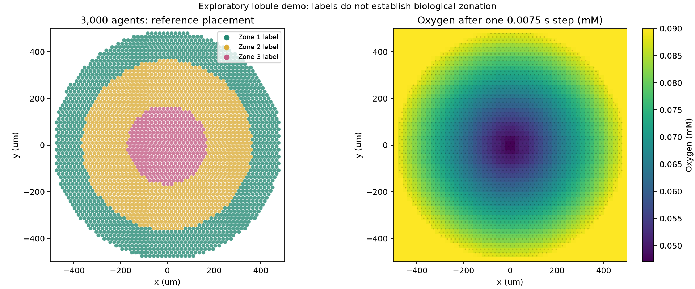

# Hepatic Lobule: 3,000-Agent Research Demo

Portable reviewer demonstration from the PhysiCell-dFBA project at Fiocruz.
This branch is self-contained and intentionally separate from `development`.
It contains selected source and inputs, not the research notebooks or large runs.



The oxygen profile includes the prescribed initial condition; the image does
not demonstrate an emergent or validated zonation pattern after one short step.

## What This Demonstrates

- A 2D reference lobule layout with **3,000 real PhysiCell agents**.
- **3,000 individual metabolic models**, 179 reactions and 175 metabolites each.
- Native C++/Clp joint optimization across 1,884 occupied voxels.
- One **0.0075-second simulated step**, with oxygen transport and all 20 local
  finite resource fields. Python launches and verifies; it does not optimize fluxes.
- A staged native worker, isolated by Linux fork, and a coordinator that validates
  the snapshot against the exact payload certified before acknowledgment.
- An optional file-replacement fault that must be rejected without changing the
  parent world. No post-optimization stock repair or solved-flux rescaling.

**This is not a continuous 720-minute run, validated biological zonation, or a
tumor simulation.** Zone colors are reference labels, not validated phenotypes.
Cycle, death, motility and native uptake callbacks are disabled. The snapshot is
not a complete resumable checkpoint; the parent's live world is not promoted.
Only oxygen is transported here; other fields have local metabolic debits.

## Quick Start: Ubuntu 24.04 or WSL2

```bash
git clone --depth 1 --single-branch --branch demo/lobule-3000-reviewers https://github.com/MatheusAmorim7/HepatoModel-dFBA.git
cd HepatoModel-dFBA
sudo apt-get update
sudo apt-get install -y build-essential cmake pkg-config coinor-libclp-dev liblapack-dev libsbml5-dev python3-venv
python3 -m venv .venv
.venv/bin/pip install -r requirements.txt
cmake -S . -B build -DCMAKE_BUILD_TYPE=Release
cmake --build build -j 2
.venv/bin/python run_demo.py
.venv/bin/python verify_demo.py results/normal/demo_committed.f64
.venv/bin/python plot_demo.py --result results/normal/demo_committed.f64 --output results/normal/lobule.png
```

Allow a few minutes for compilation and initialization. Processing time is NOT
simulated biological time. At least 2 GB free memory is recommended. The program
requires Linux fork; use WSL2 rather than native Windows Python.

Expected normal output: `accepted_snapshot: true`, 3,000 agents/models, 1,884
joint voxel LP calls, one scheduler entry and `clock_min: 0.000125`.
`verify_demo.py` independently checks stoichiometry, bounds, resource debits,
gross shared uptake and aggregate C/N accounting. Output folders must be new;
the runner does not overwrite previous results.

## Rejection Control

```bash
.venv/bin/python run_demo.py --mode candidate_replace --output results/rejected
```

This is an injected software fault, not a biological condition. The worker
rewrites both candidate and final files after authorization. The coordinator
must return `accepted_snapshot: false` and `certified_payload_mismatch`.
The launcher expects that rejection and exits successfully when verified.
Retained altered files are failure evidence, not accepted simulation results.

## Scientific Scope

The inherited operational scale is 0.12 pmol/h per normalized flux unit, not
measured cell dry mass. ATP maintenance is fixed at 5 and the urea lower bound at
1.77516401358732 per host. The external selector minimizes mean total absolute
flux, not growth or minimum serine support; `r1032` is not its objective.

Medium, capacities, volumes and task scale remain exploratory. No C/N feed is
implemented. Glutamine is the only effective imported nitrogen source, and a
fixed urea task is required. Zero glucose/serine exchange under minimum L1 does
not establish absent glucose use or lost serine-production capacity in real cells.
The earlier conditional nitrogen exclusion at 60 seconds remains unresolved;
passing one short step does not establish long-term feasibility or viability.
Only 1/175 metabolites has a formula annotation: aggregate C/N checks do not
constitute full elemental/charge validation. No therapeutic conclusions follow.

The first scheduler call invokes inert markers using inherited 2 min phenotype
and 0.1 min mechanics bootstrap intervals; these are not calibrated cell kinetics.
There is no filesystem sandbox, crash recovery, or general hostile-IPC guarantee.

## Provenance and Citations

The research source lineage is recorded in `SOURCE_PROVENANCE.json`. Portable
changes affect include paths, build/distribution and presentation, not equations,
task bounds or finite-resource accounting. The original root project remains
separate. See `NOTICE.md` and `licenses/` for upstream attribution and limitations.

- Ghaffarizadeh et al. PhysiCell. PLoS Comput Biol (2018), doi:10.1371/journal.pcbi.1005991.
- Gille et al. HepatoNet1. Mol Syst Biol (2010), doi:10.1038/msb.2010.62.
- Vlassis et al. FastCORE. PLoS Comput Biol (2014), doi:10.1371/journal.pcbi.1003424.

This demo does not claim to reproduce a published zonation benchmark yet.
